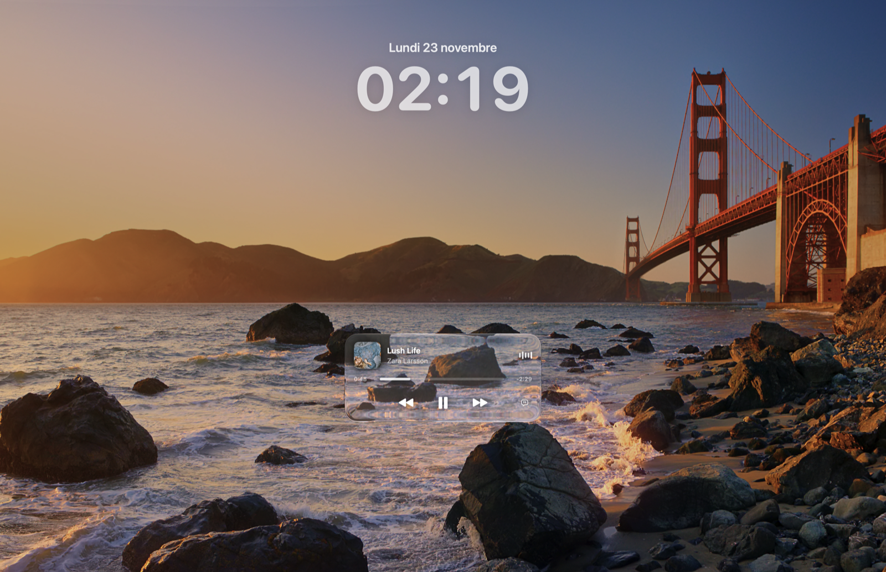
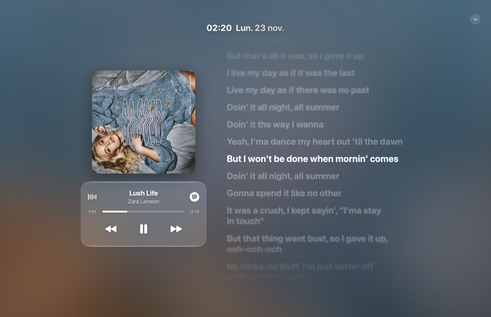

# LockPlayer



| Pochette en grand | Paroles synchronisées |
|---|---|
|  |  |

Affiche la musique en cours (Spotify ou n'importe quel lecteur) sur l'écran verrouillé du Mac :

- **mini-lecteur en verre** : pochette, titre, progression (cliquable), ◀◀ ❚❚ ▶▶ ;
- **clic sur la pochette** → pochette en grand sur fond flouté aux couleurs de l'album (façon iPhone) ;
- **bouton paroles** (en bas à droite) → paroles synchronisées qui défilent ; clic sur une ligne = aller à ce moment ;
- **égaliseur** qui bouge avec le vrai son du Mac ;
- **heure et date** en haut de la vue en grand, comme sur iPhone ;
- **écran allumé** tant que la musique joue sur l'écran verrouillé (option).

L'app vit dans la barre des menus : aperçu sans verrouiller, position du lecteur, synchro des paroles, lancement au démarrage. Logo et guide d'identité : `Branding/logo/`.

## Compiler

```bash
brew install xcodegen   # une seule fois
xcodegen generate
open LockPlayer.xcodeproj   # puis ⌘R
```

Signature : ad hoc par défaut. Pour que macOS garde les autorisations (son, Spotify) d'une compilation à l'autre, copier `Config/Local.xcconfig.example` en `Config/Local.xcconfig` et y mettre son certificat Apple Development (ce fichier n'est pas versionné).

Pour l'installer : copier `LockPlayer.app` (Product ▸ Show Build Folder) dans `/Applications`, puis activer « Lancer au démarrage » dans le menu.

Tester sans verrouiller :

```bash
open build/DerivedData/Build/Products/Debug/LockPlayer.app --args --preview          # mini-lecteur
open build/DerivedData/Build/Products/Debug/LockPlayer.app --args --preview --lyrics # plein écran + paroles
```

## Comment ça marche

| Besoin | Technique | Fichier |
|---|---|---|
| Morceau en cours | [mediaremote-adapter](https://github.com/ungive/mediaremote-adapter) lancé via `/usr/bin/perl` (seul moyen depuis macOS 15.4), secours AppleScript Spotify | `Services/PlayerSources.swift` |
| Écran verrouillé | Framework privé SkyLight : un « space » au niveau 400, au-dessus du lock screen (d'après [SkyLightWindow](https://github.com/Lakr233/SkyLightWindow), MIT) | `Services/LockScreen.swift` |
| Verrouillage | Notifications `com.apple.screenIsLocked` / `screenIsUnlocked` | `Services/LockScreen.swift` |
| Paroles | API gratuite [LRCLIB](https://lrclib.net), cache dans `~/Library/Caches/LockPlayer/lyrics` | `Services/Lyrics.swift` |

Les panneaux sont `nonactivating` et ne deviennent jamais « key » : le champ mot de passe garde le clavier.

## Limites

- APIs privées → pas d'App Store, et une mise à jour de macOS peut casser l'affichage ou la lecture. Si la musique n'apparaît plus : `scripts/update-adapter.sh`, puis recompiler.
- macOS 26+ affiche aussi son propre lecteur au-dessus du mot de passe : la position par défaut « Sous l'horloge » évite le chevauchement.
