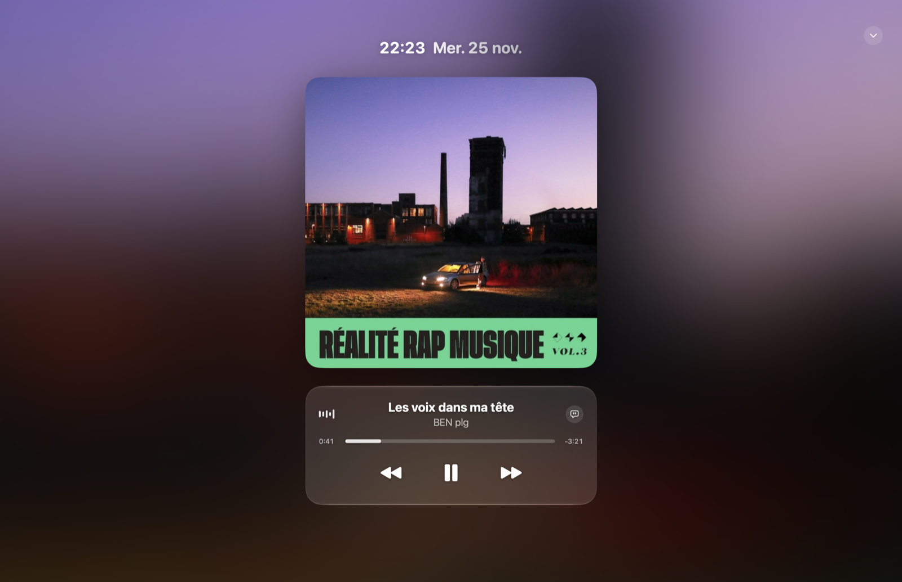
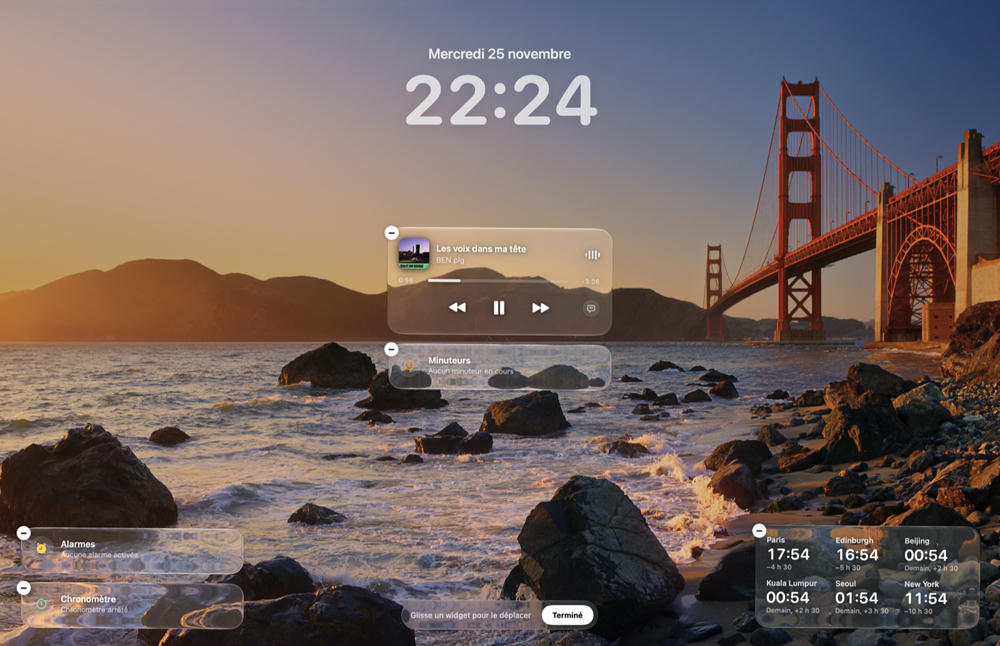

# LockPlayer


Des widgets en Liquid Glass sur l'écran verrouillé du Mac : la musique en cours, les minuteurs, alarmes et chronomètres de l'app Horloge, et l'heure dans d'autres villes. Chaque widget se place où l'on veut.

| Pochette en grand | Paroles synchronisées |
|---|---|
|  |  |

## Les widgets

- **Musique** (Spotify ou n'importe quel lecteur) : pochette, titre, progression cliquable, ◀◀ ❚❚ ▶▶, égaliseur qui bouge avec le vrai son du Mac.
  - Clic sur la pochette : pochette en grand sur un fond flouté aux couleurs de l'album, avec l'heure et la date en haut, comme sur l'iPhone.
  - Bouton paroles : paroles synchronisées qui défilent ([LRCLIB](https://lrclib.net)). Un clic sur une ligne va à ce moment du morceau.
  - Deux tailles : le lecteur complet ou un lecteur compact.
- **Minuteurs**, **Alarmes**, **Chronomètre** : ceux de l'app **Horloge** d'Apple, affichés comme les activités en direct de l'iPhone. C'est de la lecture seule : un clic ouvre Horloge. Quand ça sonne, la carte passe en couleur et l'écran se rallume.
- **Horloges** : les villes de l'onglet Horloges d'Horloge, sauf celles qui ont déjà l'heure du Mac. Trois tailles, et les villes affichées se choisissent une par une.

Un widget n'apparaît que s'il a quelque chose à montrer.

## Placer et régler les widgets



- **Modifier les widgets…** (menu de la barre des menus, ⌘E) : un faux écran verrouillé sans profil.
  - On glisse chaque widget. Il se cale sur l'un des 8 crans aimantés (coins, côtés, sous l'horloge, au-dessus du profil), et un fantôme montre où il va se poser.
  - Le badge **−** retire un widget, la barre du bas permet de le remettre.
- **Sur l'écran verrouillé** : un appui long sur un widget le soulève, puis on le glisse.
- **Clic droit** (ou clic à deux doigts) sur un widget : taille, villes affichées, retirer le widget.

Plusieurs widgets peuvent partager un cran : ils s'empilent sans se chevaucher.

## Installer

```bash
brew install xcodegen   # une seule fois
xcodegen generate
xcodebuild -project LockPlayer.xcodeproj -scheme LockPlayer -configuration Release -derivedDataPath build/DerivedData build
```

Copier ensuite `build/DerivedData/Build/Products/Release/LockPlayer.app` dans `/Applications`. Installée là, l'app se lance toute seule à l'ouverture de session.

**Autorisations demandées par macOS :**
- **Son du système** : pour animer l'égaliseur (rien n'est enregistré).
- **Contrôle de Spotify** : pour caler les paroles sur la position exacte du morceau.
- **Accès complet au disque** (Réglages Système › Confidentialité et sécurité), à ajouter à la main : seulement pour le widget Horloges, parce que la liste des villes d'Horloge est dans son dossier protégé.

**Signature :** elle est ad hoc par défaut. Pour que macOS garde les autorisations d'une compilation à l'autre, copier `Config/Local.xcconfig.example` en `Config/Local.xcconfig` et y mettre son certificat Apple Development. Ce fichier n'est pas versionné.

**Options de test :**

```bash
open /Applications/LockPlayer.app --args --preview            # widgets sans verrouiller
open /Applications/LockPlayer.app --args --showcase           # faux écran verrouillé, sans profil (captures)
open /Applications/LockPlayer.app --args --showcase --lyrics  # pochette en grand + paroles
open /Applications/LockPlayer.app --args --edit-widgets       # mode « Modifier les widgets »
```

## Comment ça marche

| Besoin | Technique | Fichier |
|---|---|---|
| Morceau en cours | [mediaremote-adapter](https://github.com/ungive/mediaremote-adapter) lancé via `/usr/bin/perl` (seul moyen depuis macOS 15.4), secours AppleScript Spotify ; position recalée sur Spotify | `Services/PlayerSources.swift` |
| Écran verrouillé | Framework privé SkyLight : un « space » au niveau 400, au-dessus de l'écran verrouillé (d'après [SkyLightWindow](https://github.com/Lakr233/SkyLightWindow), MIT) | `Services/LockScreen.swift` |
| Minuteurs, alarmes, chronos d'Horloge | Préférences `com.apple.mobiletimerd` lues en direct via `CFPreferences` (le service d'Horloge, lui, exige une autorisation privée d'Apple) | `Services/ClockActivities.swift` |
| Villes d'Horloge | Clé `cities` de `com.apple.mobiletimer.plist` dans le conteneur d'Horloge (Accès complet au disque) | `Services/WorldClocks.swift` |
| Widgets et crans | Un panneau par widget, piles calculées par cran, disposition enregistrée dans les préférences | `Services/WidgetLayout.swift`, `Views/WidgetViews.swift` |
| Égaliseur | Tap audio Core Audio + FFT (Accelerate) | `Services/AudioLevels.swift` |
| Paroles | API gratuite [LRCLIB](https://lrclib.net), cache dans `~/Library/Caches/LockPlayer/lyrics` | `Services/Lyrics.swift` |

Les panneaux sont `nonactivating` et ne deviennent jamais « key » : le champ mot de passe garde le clavier. Seules les cartes captent la souris, et les clics passent à travers les marges transparentes.

Logo et guide d'identité : `Branding/logo/`.

## Limites

- **API privées** : pas d'App Store, et une mise à jour de macOS peut casser l'affichage, la lecture ou la lecture d'Horloge. Si la musique n'apparaît plus : `scripts/update-adapter.sh`, puis recompiler.
- **Horloge en lecture seule** : impossible de mettre en pause ou d'arrêter un minuteur depuis LockPlayer.
- **Clic droit** : sur le vrai écran verrouillé, macOS peut ne pas afficher le menu. Les widgets se règlent alors depuis le mode édition.
